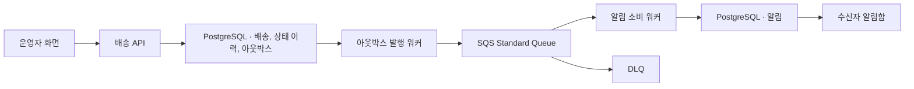

# Logistics Notification Lab 구현 계획

## 프로젝트 목표

배송 상태를 관리하고 고객에게 상태 변경을 알려주는 소형 물류 시스템을 만든다. 채용 검토자가 GitHub에서 배송 한 건을 직접 처리하고, SQS 알림이 중복 수신과 처리 실패를 어떻게 다루는지 재현할 수 있게 한다. 실무에서 다뤄 온 물류 알림 문제를 바탕으로 공개 예제의 업무 흐름, 데이터, 구현을 독립적으로 설계한다.

## MVP 범위

- 운영자 화면에서 가상의 배송을 등록하고 배송 목록, 상세 정보, 상태 이력을 조회한다.
- 배송 상태는 `등록 → 배송 중 → 배송 완료` 순으로 전이한다. 배송 중에는 `배송 예외`로 전환할 수 있고, 예외 해결 후 배송 중으로 복귀할 수 있다.
- 배송 시작, 배송 예외 발생, 배송 완료 시 수신자에게 인앱 알림을 생성한다. 예외 복구에 따른 배송 재개는 별도 알림 없이 이력에 기록한다.
- 수신자 화면에서 자신의 배송 알림을 조회하고 읽음 처리한다. 로컬 데모는 시드 계정을 사용하고 공개 저장소에는 가상 데이터만 포함한다.
- 운임·재고·운송장 연동과 실제 이메일·문자 발송은 후속 범위로 둔다.

## 기술 구성

| 구성 | 초안 |
| --- | --- |
| API와 백그라운드 프로세스 | NestJS, TypeScript, TypeORM. 한 저장소에서 API와 워커를 별도 프로세스로 실행 |
| 화면 | React로 운영자 배송 화면과 수신자 알림함 구성 |
| 저장소 | PostgreSQL에 배송, 상태 이력, 아웃박스 이벤트, 알림 저장 |
| 메시징 | AWS SDK for JavaScript v3, Amazon SQS Standard Queue와 DLQ |
| 실행 환경 | Docker Compose로 공식 AWS Emulator의 SQS 실행. 배송 API 구현 단계에서 PostgreSQL 추가 |

### 로컬 SQS 실행

Windows에서는 Docker Desktop을 Linux 컨테이너 모드로 실행한다. 스모크 테스트는 공식 AWS CLI v2 이미지 안에서 실행된다. 프로젝트 폴더에서 아래 명령을 실행한다.

```powershell
docker compose up -d --build aws-emulator
docker compose run --rm sqs-smoke
```

Compose는 AWS가 배포하는 Linux RPM으로 이미지를 빌드하고 `https://127.0.0.1:9297`에만 포트를 공개한다. 기본 패키지는 x86_64용이다. ARM64에서는 빌드 전에 PowerShell에서 `$env:AWS_EMULATOR_RPM_ARCH = 'aarch64'`를 설정한다. 에뮬레이터가 생성한 임시 키와 인증서는 Git에서 제외한 `.aws-emulator/9297/`에 저장된다. 컨테이너를 다시 시작하면 큐를 다시 생성한다.

스모크 테스트는 임시 Standard Queue를 생성하고 메시지 전송, 수신, 삭제를 확인한다. NestJS 워커를 구현할 때는 로컬 프로세스 시작 전에 `AWS_ENDPOINT_URL`, `AWS_SHARED_CREDENTIALS_FILE`, `AWS_CONFIG_FILE`, `AWS_REGION`, `NODE_EXTRA_CA_CERTS`를 로컬 설정으로 지정한다. CI에서도 AWS 계정 없이 기본 알림 흐름을 실행하도록 구성한다. DLQ 자동 이동과 원본 큐로의 redrive는 에뮬레이터에서 먼저 검증하고, 지원 차이가 확인되는 동작은 테스트용 AWS SQS에서 검증한다.

## 배송 상태에서 알림까지



1. 배송 API는 허용된 상태 전이를 검증한다. 버전을 조건으로 상태를 갱신하고 상태 이력과 알림 대상 이벤트를 같은 DB 트랜잭션에 저장한다. 동시 요청에서 버전이 바뀌었다면 충돌로 응답한다.
2. 발행 워커는 미발행 아웃박스를 읽어 SQS로 전송하고 성공 응답을 받은 뒤 발행 시각을 저장한다. 실패 시 다음 시도 시각을 기록하고 지수 백오프로 재시도한다. 전송 직후 워커가 중단되면 같은 이벤트가 재발행될 수 있으므로 아웃박스에서 생성한 `eventId`를 유지한다. MVP에서는 발행 워커를 한 인스턴스로 실행한다.
3. 알림 워커는 SQS 롱 폴링으로 메시지를 받고 이벤트 스키마를 검증한다. `(event_id, recipient_id)` 고유 제약으로 알림 생성을 멱등하게 처리하며, DB 커밋이 끝나거나 기존 알림을 확인한 뒤 메시지를 삭제한다.
4. 처리 실패 시 메시지를 삭제하지 않는다. 가시성 타임아웃 이후 재수신하며, 반복 실패한 메시지는 큐의 재처리 정책에 따라 DLQ로 이동한다. 원인 수정 후 DLQ에서 원본 큐로 돌려보내고, 같은 이벤트 ID를 유지한다.

### 이벤트와 순서

이벤트에는 `eventId`, `eventType`, `schemaVersion`, `shipmentId`, `shipmentVersion`, `recipientId`, `occurredAt`을 담는다. 이벤트 유형은 `ShipmentInTransit`, `ShipmentExceptionRaised`, `ShipmentDelivered`로 시작한다.

SQS Standard는 중복 수신과 순서 뒤바뀜이 가능하다. 각 알림은 발생 당시의 배송 상태를 설명하고, 알림함은 이벤트 발생 시각을 기준으로 정렬한다. 배송 상세 화면의 현재 상태는 배송 테이블에서 조회한다. 알림이 늦게 도착해도 배송 상태를 갱신하는 경로는 배송 API로 한정한다.

## 구현 순서

| 단계 | 작업 | 완료 기준 |
| --- | --- | --- |
| 1. 배송 | NestJS, PostgreSQL, 마이그레이션, 시드 데이터 구성. 배송 등록·조회·상태 변경 API 구현 | 허용된 변경은 이력과 함께 저장되고, 동시 변경 또는 잘못된 상태 전이는 거부된다. |
| 2. 알림 | 아웃박스, 발행 워커, SQS, 소비 워커, 알림 조회·읽음 처리 API 구현 | 배송을 시작하면 시드 수신자의 알림함 API에 알림 한 건이 나타난다. |
| 3. 화면 | 배송 목록·상세와 알림함 구현 | 화면에서 배송 등록부터 배송 완료 및 알림 읽음 처리까지 진행할 수 있다. |
| 4. 장애 검증 | 중복, SQS 전송 실패, DB 커밋 후 메시지 삭제 실패, DLQ 이동·복구 검증. 구조화 로그에 `eventId`, `shipmentId`, 수신 횟수 기록 | 아래 시나리오를 AWS Emulator에서 재현하고, 지원 차이가 있는 경우 테스트용 AWS SQS에서 결과를 기록한다. |
| 5. GitHub 정리 | README, 실행 명령, 아키텍처 그림, 화면 캡처, 장애 재현 절차 작성. CI에서 빌드와 테스트 실행 | 처음 보는 사람이 새로 내려받아 README만으로 로컬 데모를 실행할 수 있다. |

## 장애 검증 시나리오

| 시나리오 | 기대 결과 |
| --- | --- |
| 배송 상태 변경 트랜잭션 롤백 | 상태, 이력, 이벤트가 함께 롤백되어 알림이 생성되지 않는다. |
| SQS 전송 실패 | 배송 상태와 이력은 저장된다. 아웃박스의 미발행 이벤트는 큐 복구 후 발행된다. |
| 동일 이벤트를 동시에 두 번 소비 | 수신자 알림은 한 건만 저장된다. |
| 알림 저장 직후 메시지 삭제 실패 | 메시지를 다시 받아도 기존 알림 한 건을 유지하고 삭제를 재시도한다. |
| 배송 완료 메시지가 배송 시작 메시지보다 먼저 도착 | 알림함은 이벤트 발생 시각에 맞춰 표시하고 배송 상세의 현재 상태는 배송 완료로 유지된다. |
| 메시지 처리가 반복 실패 | DLQ 이동을 확인한다. 워커 문제를 수정하고 같은 메시지를 다시 처리해 알림 한 건을 생성한다. |

## GitHub와 면접 데모

README 첫 화면에 프로젝트 소개, 배송 상세와 알림함 캡처, 로컬 실행 명령을 배치한다. 데모는 배송 시작 알림을 받은 뒤 동일 이벤트를 다시 전달하고, 이어서 처리 실패 메시지를 DLQ에서 복구하는 순서로 구성한다. 면접에서는 배송 API와 알림 처리의 경계, 아웃박스 도입 이유, Standard Queue에서의 중복 및 순서 처리, 발행 지연과 DLQ 적재를 어떻게 파악하는지를 설명한다. 설정 예시는 `.env.example`에 담고 실제 AWS 자격 증명은 GitHub에 올리지 않는다.

## 설계 참고

- [AWS Emulator Docker 실행](https://docs.aws.amazon.com/emulator/latest/userguide/getting-started-docker.html)
- [AWS Emulator SDK 연결 및 Node.js 인증서 설정](https://docs.aws.amazon.com/emulator/latest/userguide/point-sdk-to-emulator.html)
- [AWS Transactional Outbox 패턴](https://docs.aws.amazon.com/prescriptive-guidance/latest/cloud-design-patterns/transactional-outbox.html)
- [Amazon SQS 가시성 타임아웃](https://docs.aws.amazon.com/AWSSimpleQueueService/latest/SQSDeveloperGuide/sqs-visibility-timeout.html)
- [Amazon SQS Dead-Letter Queue](https://docs.aws.amazon.com/AWSSimpleQueueService/latest/SQSDeveloperGuide/sqs-dead-letter-queues.html)
