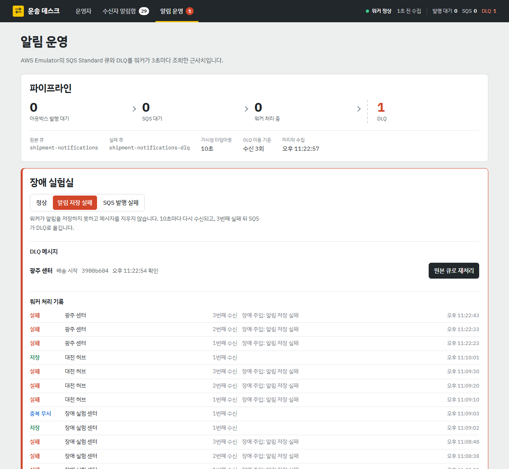
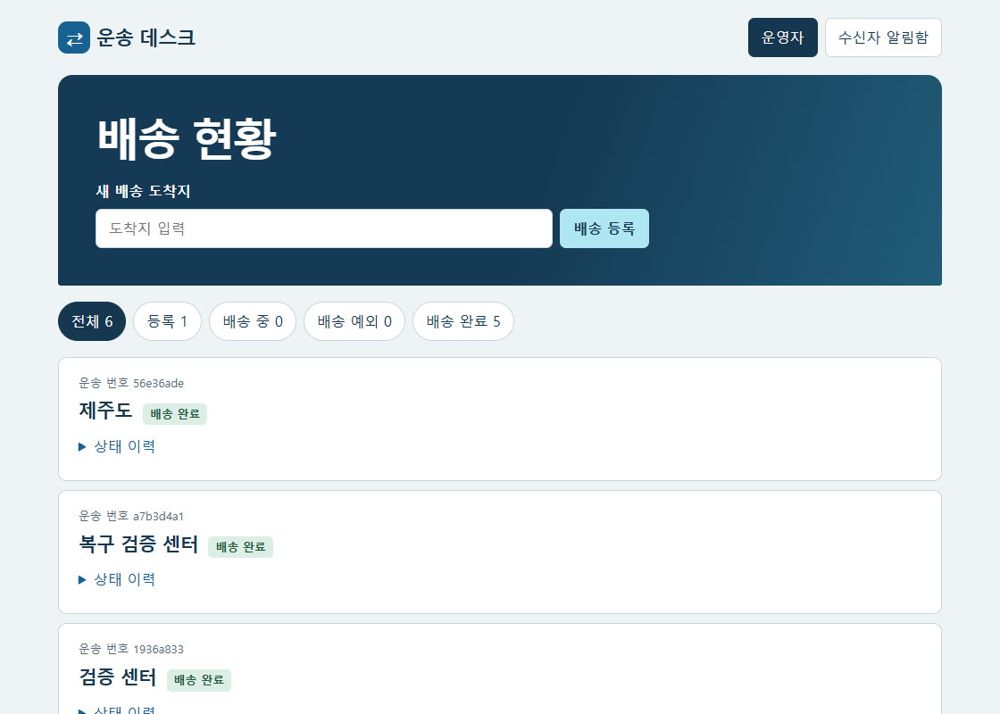
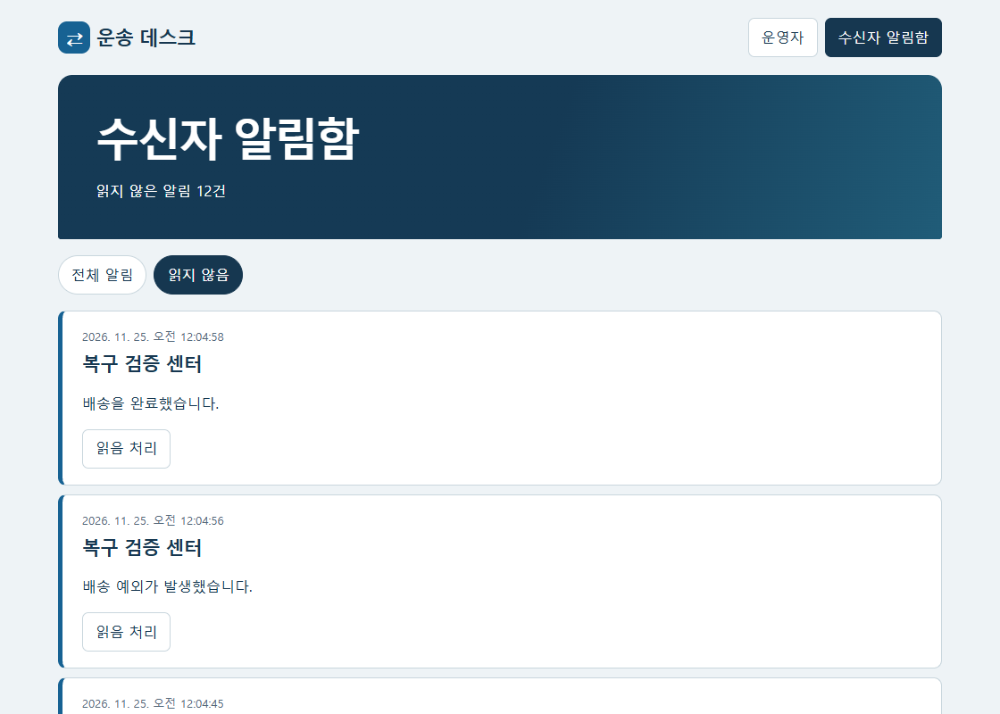
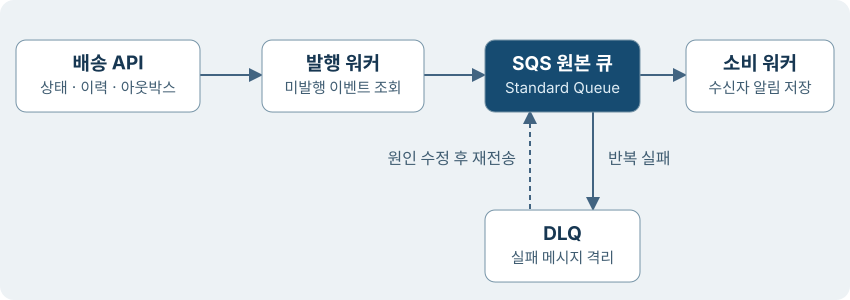

# Logistics Notification Lab · 운송 데스크

배송을 시작하면 수신자의 알림함에 몇 초 뒤 알림이 도착합니다. 이 프로젝트는 그 사이에 일어나는 일을 직접 확인할 수 있는 물류 데모입니다. 운영자는 배송 상태와 이력을 관리하고, 백그라운드 워커는 **PostgreSQL 아웃박스와 Amazon SQS**를 통해 수신자 알림을 생성합니다.

**확인할 수 있는 세 가지**

같은 배송을 두 번 시작하면 한 요청만 성공합니다. 같은 이벤트가 두 번 도착해도 알림은 한 건입니다. 반복해서 실패한 메시지는 DLQ에서 원인을 확인하고 한 건만 골라 복구할 수 있습니다.

## 로컬에서 배송 한 건 보내기

Docker Compose와 Linux 컨테이너를 준비합니다. Windows의 Docker Desktop에서는 아래 명령을 그대로 실행합니다. Linux에서는 먼저 에뮬레이터 디렉터리를 `sudo install -d -o 1000 -g 1000 .aws-emulator`로 준비합니다. ARM64에서는 빌드 인자 `AWS_EMULATOR_RPM_ARCH`를 `aarch64`로 설정합니다.

```sh
git clone https://github.com/edgarshlee/logistics-notification-lab.git
cd logistics-notification-lab
docker compose up -d --build
```

1. [로컬 운송 데스크](http://localhost:3180)를 열고 도착지를 입력한 뒤 **배송 등록**을 누릅니다.
2. **배송 시작**을 누르고 **수신자 알림함**으로 이동합니다. 화면은 3초마다 갱신됩니다.
3. 알림을 읽음 처리한 뒤 운영자 화면에서 **예외 등록 → 배송 재개 → 배송 완료**를 시도합니다. 배송 재개는 이력에만 기록되며, 이 흐름에서 수신자는 알림 세 건을 받습니다.
4. [알림 운영 · SQS](http://localhost:3180/#operations)에서 최근 배송 이벤트를 찾습니다. 이벤트 ID별 SQS 발행 시각과 알림 저장 결과를 확인할 수 있습니다. 상단 큐 현황은 워커가 3초마다 조회한 SQS 근사치입니다. 정상 처리 직후 대기 건수가 0이어도 아래 이벤트 이력은 남습니다.



<details><summary>배송 현황과 수신자 알림함 화면</summary>




</details>

운영자와 수신자는 같은 로컬 데모를 보는 두 화면입니다. 수신자는 가상 계정 한 명으로 고정했습니다. `docker compose down`으로 종료하면 PostgreSQL 볼륨에 배송과 알림이 보존됩니다. 에뮬레이터 큐는 메모리에 있으므로 종료하면 대기 메시지가 사라집니다.

## 배송 이벤트가 알림이 되는 과정



배송 API는 행 잠금과 요청 버전으로 동시 변경을 검사하고 **배송 상태·이력·아웃박스 이벤트**를 한 트랜잭션에 저장합니다. 발행 워커는 미발행 이벤트를 큐로 보냅니다. 전송에 실패하면 DB에 다음 시도 시각을 기록하고 최대 60초 간격까지 재시도합니다.

소비 워커는 알림 저장을 마친 후 SQS 메시지를 삭제합니다. 그 사이 프로세스가 중단되면 같은 이벤트가 다시 도착할 수 있습니다. 이때 PostgreSQL의 `(event_id, recipient)` 고유 키가 중복 생성을 막습니다. 늦게 도착한 이벤트는 발생 시각에 맞춰 알림함에 표시되며 배송의 현재 상태는 배송 테이블에서 조회합니다.

## SQS와 DLQ 설정

워커가 시작할 때 공식 **AWS Emulator**에 DLQ를 먼저 만들고, 반환된 ARN을 원본 큐의 `RedrivePolicy`에 연결합니다. 로컬에서 AWS 계정이나 개인 액세스 키를 입력할 필요가 없습니다.

| 설정 | 프로젝트 값 | 동작 |
| --- | --- | --- |
| 원본 큐 | `shipment-notifications` · Standard | 배송 시작·예외·완료 이벤트 전달 |
| 실패 큐 | `shipment-notifications-dlq` | 반복 처리에 실패한 메시지 격리 |
| 가시성 타임아웃 | 10초 | 삭제하지 않은 메시지는 다시 수신 가능 |
| 최대 수신 횟수 | `maxReceiveCount = 3` | 재수신 한도에 도달한 메시지는 SQS가 DLQ로 이동 |
| 소비 방식 | 롱 폴링 2초, 최대 10건 | 개별 메시지 처리 결과에 따라 삭제 |

### 장애와 복구 직접 확인하기

```sh
docker compose run --rm sqs-smoke
docker compose exec -T worker node dist/demo-test.js
docker compose logs --tail=80 worker
```

첫 명령은 임시 큐를 만들어 송수신과 삭제를 검사합니다. 두 번째 명령은 배송을 등록하고 동시 변경, 잘못된 전이, 이벤트 재전송, 읽음 처리를 검증합니다. 이어서 **아직 존재하지 않는 배송 ID**를 가진 메시지를 보냅니다. 외래 키 제약으로 저장이 실패하면 워커는 메시지를 삭제하지 않습니다.

테스트는 해당 이벤트가 DLQ에 도착할 때까지 기다린 뒤 누락된 배송과 이력을 복구합니다. 같은 이벤트 ID로 원본 큐에 다시 보내고 DLQ 메시지를 삭제한 뒤, 수신자 알림함에 나타나는 것까지 확인합니다. 선택한 한 건만 재처리하는 시나리오이며 테스트 데이터는 화면에 남습니다. 성공하면 `PASS DLQ routing and selective replay`가 출력됩니다.

## 코드 둘러보기

| 코드 | 확인할 내용 |
| --- | --- |
| [배송 API](src/api.ts) | 상태 전이, 동시 변경 거부, 트랜잭션 경계 |
| [데이터베이스](src/db.ts) | 테이블, 기본 배송, 알림 중복 방지 키 |
| [SQS 워커](src/worker.ts) | 큐와 DLQ 초기화, 발행 재시도, 메시지 처리와 삭제 |
| [통합 테스트](src/demo-test.ts) | 실제 HTTP·PostgreSQL·에뮬레이터를 거치는 장애 재현 |
| [React 화면](web/app.jsx) | 배송 현황과 이력, 수신자 알림함 |

NestJS · TypeScript · TypeORM · PostgreSQL · React · AWS SDK for JavaScript v3를 사용합니다. [구현 계획](PLAN.md)과 [CI 워크플로](.github/workflows/test.yml)에서 설계 배경과 검증 절차를 확인할 수 있습니다.
